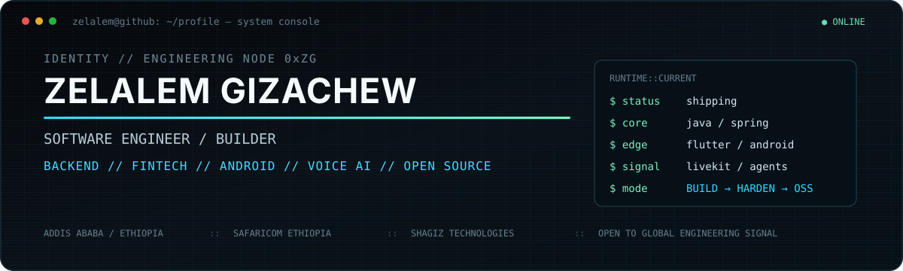
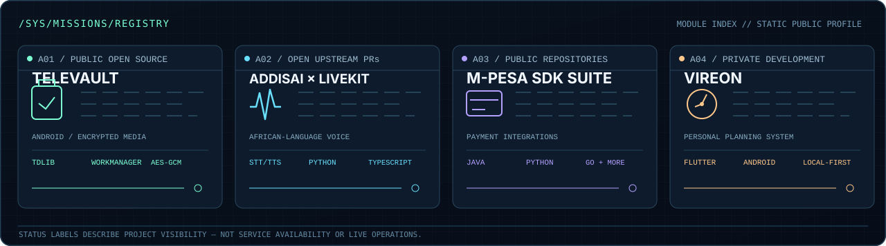
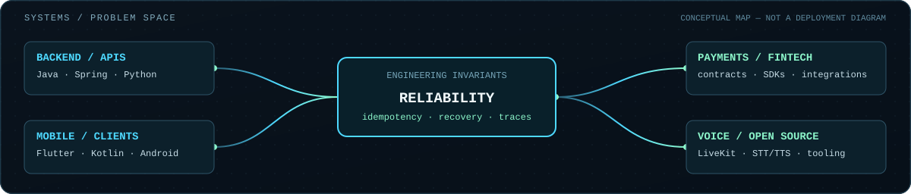

<!--
  ZG / ENGINEERING OS
  A hand-built GitHub profile. Visual assets live in ./assets.
  Public-facing status information is descriptive, not live telemetry.
-->

 

  

**The systems should be interesting. Their failure modes should be boring.**

SOFTWARE ENGINEER · SAFARICOM ETHIOPIA · ADDIS ABABA, ETHIOPIA

---

### \`00 / boot_sequence\`

~~~console
$ ssh zelalem@engineering-os
Authenticating... [human]
Loading engineering profile...

IDENTITY     Zelalem Gizachew
ROLE         Software Engineer
DOMAIN       Backend Engineering / Fintech / Realtime AI / Android
LOCATION     Addis Ababa, Ethiopia
MODE         BUILD  →  SHIP  →  BREAK  →  HARDEN  →  OPEN SOURCE

> Welcome to the part of the internet where failure paths are first-class features.
~~~

I work on **fintech and digital-channel engineering at Safaricom Ethiopia**. Outside my day job, I build products, developer tooling, and open-source integrations. I gravitate toward the problems that appear *after* the happy-path demo: concurrency, retries, state reconciliation, unreliable networks, latency, and observability.

My engineering interests span backend platforms, payment APIs, Android systems, and low-latency voice agents. **The connecting principle is operational reliability.**

### \`01 / mission_registry\`

<table>
<tr>
<td width="50%" valign="top">

#### <a href="https://github.com/Shagiz-Technologies/televault">A01 / TELEVAULT ↗</a>

**Storage and privacy infrastructure disguised as an Android media app.**

Public, open-source Android backup manager and encrypted vault built around user-controlled Telegram storage.

- TDLib integration and resilient background uploads
- Sync state and crash recovery
- Retry / flood-wait handling and Android WorkManager
- Streaming AES-256-GCM encrypted vault containers
- Release hardening, privacy and CI workflows

<code>Flutter</code> · <code>Kotlin</code> · <code>TDLib</code> · <code>Drift/SQLite</code>

**[Explore source →](https://github.com/Shagiz-Technologies/televault)**

</td>
<td width="50%" valign="top">

#### A02 / ADDISAI × LIVEKIT

**African-language speech integrations for realtime AI agents.**

Proposed upstream STT/TTS provider plugins for **Amharic** and **Afaan Oromo** in two LiveKit ecosystems.

- Asynchronous provider requests and error mapping
- Retry-safe, idempotent speech generation flows
- Tests, documentation, and agent examples
- Python and TypeScript implementations

<code>LiveKit Agents</code> · <code>Python</code> · <code>TypeScript</code> · <code>STT/TTS</code>

**[Python PR #6601 →](https://github.com/livekit/agents/pull/6601)** · **[Node.js PR #2160 →](https://github.com/livekit/agents-js/pull/2160)**

Both upstream pull requests are currently open, not merged.

</td>
</tr>
<tr>
<td width="50%" valign="top">

#### A03 / M-PESA SDK SUITE

**Payment integrations should have predictable developer contracts.**

Public client projects exploring API authentication, transaction requests, callbacks, and error handling across languages.

**[Java](https://github.com/ZelalemGizachew/mpesa-java-sdk)** · **[Python](https://github.com/ZelalemGizachew/mpesa-python-sdk)** · **[Go](https://github.com/ZelalemGizachew/mpesa-go-sdk)** · **[Node.js](https://github.com/ZelalemGizachew/mpesa-node-js-sdk)** · **[PHP](https://github.com/ZelalemGizachew/mpesa-php-sdk)**

<code>Payments</code> · <code>API clients</code> · <code>Authentication</code> · <code>Developer tooling</code>

</td>
<td width="50%" valign="top">

#### A04 / VIREON

**A personal planning system designed as an operating environment.**

An Android-first productivity project built around deterministic daily plans rather than infinite, mutable to-do lists.

- Frozen daily plans and routine-generated tasks
- Timed reminders and native Android notification HUDs
- Local-first state and weekly performance reviews
- Mechanical, science-fiction-inspired UI

<code>Flutter</code> · <code>Dart</code> · <code>Kotlin</code> · <code>Android</code>

Private development. No public source link yet.

</td>
</tr>
</table>

### \`02 / experimental_lab\`

**[Spring Documentation MCP Server →](https://github.com/ZelalemGizachew/spring-documentation-mcp-server)**

A separate **educational, AI-assisted experiment** in documentation-aware developer tools: Spring AI, MCP interfaces, PostgreSQL full-text search, pgvector semantic retrieval, and documentation synchronization.

This is not an official Spring project. The repository documents its AI-assisted code authorship.

### \`03 / system_topology\`

<b>Expand: what I optimize for</b>

 

| Engineering surface | The questions worth asking |
|:--|:--|
| **Distributed state** | What happens if two actors update the same thing? |
| **Failure recovery** | Can we safely resume after a timeout or crash? |
| **Payment integrations** | Is every external action identifiable and idempotent? |
| **Observability** | Can we explain *why* a transaction failed without guessing? |
| **Realtime voice** | Where is the latency budget spent, and how do interruptions behave? |
| **Android** | What survives process death, bad connectivity, and background limits? |

### \`04 / runtime_dependencies\`

### \`05 / operating_principles\`

~~~rust
// Engineering axioms. Not executable Rust.

const ASSUME_FAILURE: bool = true;
const MAKE_STATE_EXPLICIT: bool = true;
const OBSERVABILITY_IS_A_FEATURE: bool = true;

// Network call ≠ transaction.
// Retry ≠ repeat blindly.
// Shipped ≠ finished.
// Complexity belongs inside the system,
// not in the user's experience.
~~~

**I like software that is difficult to build well, but easy for someone else to depend on.**

### \`06 / open_channels\`

I’m interested in technical collaboration and international opportunities in **backend/platform engineering, fintech infrastructure, developer tools, and realtime voice/AI**.

**[Portfolio](https://zenonymous.lovable.app/)** &nbsp; / &nbsp; **[Shagiz Technologies](https://shagiz-technologies.github.io/)** &nbsp; / &nbsp; **[LinkedIn](https://www.linkedin.com/in/zelalem-gizachew-28012a230/)** &nbsp; / &nbsp; **[Email](mailto:zelalemgizachew890@gmail.com)**

ZG / ENGINEERING OS · SYSTEMS OVER HYPE · SIGNAL OVER NOISE

