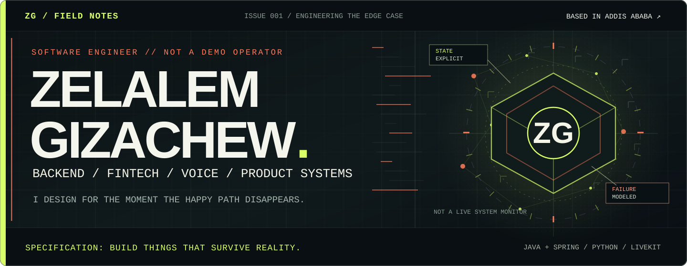
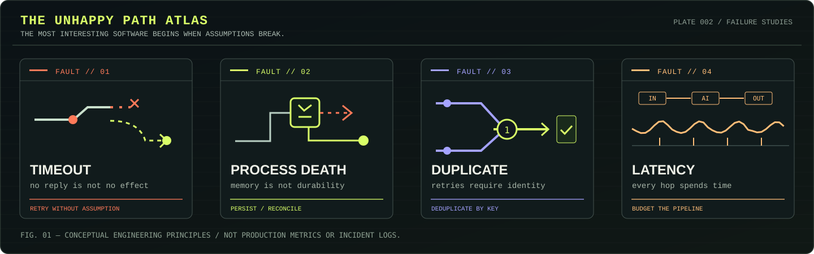
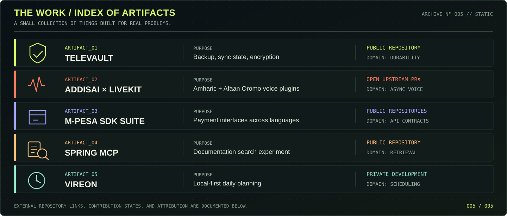

<!--
THE FAILURE DOMAIN — Field notes of Zelalem Gizachew.
Original visual assets: assets/field-notes-cover.svg,
assets/unhappy-path-atlas.svg, assets/artifact-index.svg.
These schematics are conceptual artwork, not live monitoring data.
-->

 

SOFTWARE ENGINEER AT SAFARICOM ETHIOPIA &nbsp;·&nbsp; BACKEND &nbsp;·&nbsp; FINTECH &nbsp;·&nbsp; REALTIME VOICE &nbsp;·&nbsp; ANDROID

---

## THE PREMISE: THE HAPPY PATH IS A SMALL PART OF THE STORY

A request timed out. **Did the payment happen?**

The app was killed. **Which state survived?**

Speech was generated. **Did it arrive before the conversation moved on?**

Those are the kinds of questions that make software engineering interesting to me.

I'm **Zelalem Gizachew**, a software engineer based in Addis Ababa, Ethiopia. I work on fintech and digital channels at **Safaricom Ethiopia**. Outside work, I build independent products, developer tools, and open-source integrations — especially where distributed systems, mobile clients, payments, and AI meet.

I care about **the behavior between the steps**: uncertain outcomes, retries, lost connectivity, state reconciliation, observability, and interfaces that make complex systems feel simple.

✳ &nbsp; A PERSONAL FIELD GUIDE TO BUILDING SOFTWARE THAT SURVIVES REALITY &nbsp; ✳

## PLATE 001 — THE UNHAPPY PATH ATLAS

Four recurring engineering problems — not invented performance measurements, just the failure cases worth designing around.

<b>↳ Open the field notes: how I think about failure</b>

| Symptom | The engineering question |
|:--|:--|
| Request timed out | Was the operation rejected, completed, or left uncertain? |
| App/process died | What state was durably committed, and what must be reconciled? |
| Request was replayed | Will repeating it create a second effect? |
| Voice agent feels slow | Which part of the STT → model → TTS → transport path owns the delay? |

## PLATE 002 — THE WORK, NOT JUST THE STACK

### 01 / TELEVAULT — Storage should survive interruption

**[Open the repository ↗](https://github.com/Shagiz-Technologies/televault)** · Public, open source

An Android media library, backup manager, and encrypted vault using a Telegram-backed storage model. Its most interesting surfaces are not the gallery screens:

**Stateful uploads** · **TDLib** · **Android background execution** · **retry/flood-wait handling** · **Drift/SQLite** · **streaming AES-256-GCM encryption** · **release hardening**

The product is developed under **[Shagiz Technologies](https://shagiz-technologies.github.io/)**.

### 02 / ADDISAI × LIVEKIT — Voice should tolerate the real world

**[Python integration PR #6601 ↗](https://github.com/livekit/agents/pull/6601)** · **[Node.js integration PR #2160 ↗](https://github.com/livekit/agents-js/pull/2160)**

Proposed upstream integrations that bring **Amharic** and **Afaan Oromo** speech-to-text and text-to-speech providers into LiveKit Agents.

The engineering concerns are practical: asynchronous requests, typed provider failures, retry behavior and idempotency, audio handling, and tests across **Python** and **TypeScript**.

*Both are open pull requests; neither is a merged LiveKit release.*

### 03 / M-PESA SDK SUITE — Developer experience is infrastructure

A set of public payment integration client projects, covering API authentication, transaction operations, callbacks, error handling, and language-specific interfaces.

**[Java](https://github.com/ZelalemGizachew/mpesa-java-sdk)** / **[Python](https://github.com/ZelalemGizachew/mpesa-python-sdk)** / **[Go](https://github.com/ZelalemGizachew/mpesa-go-sdk)** / **[Node.js](https://github.com/ZelalemGizachew/mpesa-node-js-sdk)** / **[PHP](https://github.com/ZelalemGizachew/mpesa-php-sdk)**

*These are public developer projects; they are not presented as official Safaricom SDKs.*

### 04 / SPRING DOCUMENTATION MCP — Make knowledge queryable

**[Explore the experiment ↗](https://github.com/ZelalemGizachew/spring-documentation-mcp-server)** · Independent educational project

A documentation-access experiment combining **Spring Boot**, **Spring AI**, **MCP**, **PostgreSQL**, and **pgvector** to explore searchable and semantically retrievable Spring documentation.

*Not an official Spring project. The repository discloses its AI-assisted code authorship.*

### 05 / VIREON — Time is a state-management problem

An Android-first planning project exploring frozen daily schedules, routine-generated tasks, local reminders, and weekly feedback — with a mechanical sci-fi visual system.

*Currently private development. No public source or release is implied.*

---

## THE TOOLBOX — ORGANIZED BY THE PROBLEMS IT SOLVES

~~~text
┌─ BACKEND / PLATFORM ──────────────────────────────────┐
│ Java · Spring Boot · Python · FastAPI · API contracts  │
├─ STATE / DELIVERY ────────────────────────────────────┤
│ PostgreSQL · Redis · Docker · Linux · CI pipelines     │
├─ MOBILE / PRODUCT ────────────────────────────────────┤
│ Flutter · Dart · Kotlin · Android · SQLite             │
├─ REALTIME / INTELLIGENCE ─────────────────────────────┤
│ LiveKit · STT/TTS · TypeScript · AI agents · MCP        │
└───────────────────────────────────────────────────────┘
~~~

The tools change. The questions are consistent: **What happens under failure? Can we explain it? Can we recover without creating more damage?**

<b>↳ Expand: the engineering rules I keep coming back to</b>

~~~text
01. A timeout is an unknown outcome — never a reliable rollback.
02. Retrying is easy. Retrying without duplicated effects is engineering.
03. State that matters must outlive the process that held it.
04. If a failure cannot be observed, it cannot be operated responsibly.
05. Realtime is a latency budget shared by every component.
06. APIs are promises to the developers who depend on them.
07. Ship the simplest system that can be understood when it breaks.
~~~

## LAST PAGE — OPEN CHANNELS

I'm interested in **backend/platform engineering, fintech infrastructure, developer tooling, mobile systems, and realtime voice/AI**, including technically ambitious open-source collaborations and international engineering opportunities.

**[SEE THE WORK](https://github.com/ZelalemGizachew?tab=repositories)** &nbsp; / &nbsp;
**[PERSONAL PORTFOLIO](https://zenonymous.lovable.app/)** &nbsp; / &nbsp;
**[SHAGIZ TECHNOLOGIES](https://shagiz-technologies.github.io/)**

**[LINKEDIN](https://www.linkedin.com/in/zelalem-gizachew-28012a230/)** &nbsp; / &nbsp;
**[EMAIL](mailto:zelalemgizachew890@gmail.com)**

 

© THE FAILURE DOMAIN / A FIELD JOURNAL BY ZELALEM GIZACHEW

**Make complex things. Make their behavior predictable.**

